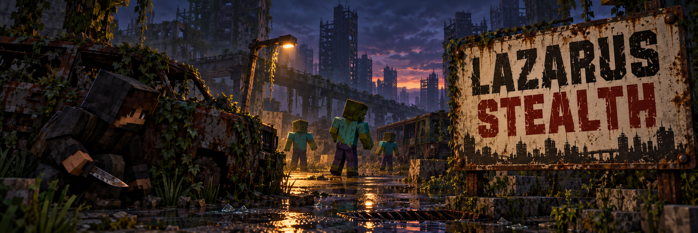
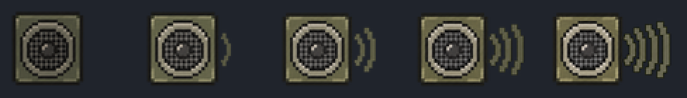

<p align="center">
  
</p>

<p align="center">
  
  
  
  
</p>

# Lazarus Stealth

**Lazarus Stealth** é um mod para Minecraft Forge 1.20.1 criado para o modpack **Project Lazarus**. Ele faz postura, cobertura, luz, ruído, peso, exaustão e habilidade mudarem de verdade a percepção dos infectados e dos humanos hostis. É possível passar agachado a poucos blocos de um zumbi desatento, despistar uma investigação e finalizá-lo em silêncio, sem que isso vire invisibilidade.

O mod não altera nenhum JAR de terceiros nem troca a IA dos mobs. Ele controla quando um mob pode ter o jogador como alvo e acrescenta dois objetivos (investigar e olhar ao redor) só nos mobs cobertos. Detecção, XP e dano são decididos no servidor, com suporte a multiplayer.

---

## Sumário

- [Como os infectados percebem você](#como-os-infectados-percebem-você)
- [NPCs humanos](#npcs-humanos)
- [Ruído](#ruído)
- [Peso e exaustão](#peso-e-exaustão)
- [Finalização furtiva](#finalização-furtiva)
- [Árvore Furtividade](#árvore-furtividade)
- [Indicador de ruído](#indicador-de-ruído)
- [Comandos e configuração](#comandos-e-configuração)
- [Instalação](#instalação)
- [O que vem dos outros mods](#o-que-vem-dos-outros-mods)
- [Créditos e licença](#créditos-e-licença)

---

## Como os infectados percebem você

Cada par **mob–jogador** tem um estado próprio, então dois jogadores no mesmo lugar podem estar em situações diferentes:

| Estado | O que o mob faz |
|---|---|
| **Desatento** | Vaga e olha ao redor; não sabe de você. |
| **Desconfiado** | Viu algo de relance: para e olha para onde viu. |
| **Investigando** | Vai até o ponto onde ouviu um som ou viu um vulto, sem saber onde você está agora. |
| **Alerta** | Ouviu algo alto, ouviu vários ruídos seguidos ou perdeu você de vista: procura e enxerga 2,5× mais rápido. |
| **Perseguindo** | Tem você como alvo. Só este estado permite atacar. |

**Visão.** A cada 6 ticks, o servidor confere:

- a distância, até 24 blocos;
- o ângulo do olhar: cone frontal de 110°, periferia lenta até 200° e nada atrás;
- quantos pontos do seu corpo estão à vista: cabeça, tronco e quadril, ou três pontos baixos se você rasteja;
- a luz onde você está;
- sua postura e sua velocidade;
- a habilidade **Corpo Baixo**.

Tudo isso enche uma barra de suspeita: um cruzamento rápido na periferia passa, ficar parado na frente do zumbi acaba em descoberta. Cercas, grades e vidro não escondem ninguém; paredes, móveis, carros e folhagem escondem.

- Encostar no zumbi (≈1,2 bloco) é descoberta imediata.
- Tocha, lanterna ou glowstone na mão, estar em chamas ou brilhando contam como luz forte.
- Ser atingido pelo jogador revela o jogador.
- **Agachar não apaga uma perseguição.** Quando perde você de vista, o zumbi vai até a última posição conhecida (6 s), procura em volta (8 s) e só então se acalma.

**Audição.** Todo ruído tem posição e alcance. Quem ouve vai **até o ponto do som**, nunca direto até você:

- **Baixo:** investiga o ponto do som.
- **Médio:** investiga mais rápido. Três ruídos médios em 10 s deixam o zumbi em Alerta.
- **Alto** ou **Extremo:** fica em Alerta e corre até o ponto.

Uma parede entre o som e o zumbi reduz o alcance a 60%. No máximo 10 infectados reagem a cada ruído.

**Zumbis sem cabeça** (Dual Hitbox) não usam a visão do mod: continuam guiados só por ruído, pela regra do próprio Dual Hitbox.

Com habilidade e condições favoráveis, dá para passar a 2–3 blocos de um zumbi desatento:

| Agachado andando a 8 blocos, de frente | Sem a árvore | Com Corpo Baixo |
|---|---|---|
| De dia | descoberto em 1,4 s | em 2,3 s |
| À noite, sem luz na mão | em 4,5 s | em 7,5 s |
| Rastejando à noite | em 7,5 s | em 12 s |

Pela periferia, tudo isso fica de 3 a 12 vezes mais lento; pelas costas, você não é visto.

---

## NPCs humanos

Com o **Lazarus NPCs 1.1.0**, os humanos do Apocalypse Now que **podem ser hostis a você** usam um perfil próprio, mais esperto que o dos zumbis:

- saqueadores, soldados desertores e canibais (exceto quem você pagou ou quem se rendeu);
- militares e sobreviventes das facções com quem você está em inimizade (reputação ≤ −40) ou que guardam rancor de você.

Caçadores e NPCs amistosos ou contratados não usam o perfil: continuam como antes e não investigam seus passos.

| Parâmetro | Zumbi | Humano |
|---|---|---|
| Alcance de visão | 24 blocos | 40 |
| Cone frontal / periferia | 110° / 200° | 140° / 240° |
| Velocidade de detecção | 1× | 1,5× |
| Escuridão total | vê 20% | vê 35% |
| Em alerta | 2,5× mais rápido | 3× mais rápido |
| Memória da última posição | 6 s | 20 s |
| Busca | 8 s, raio 5 | 20 s, raio 8 |
| Ruído baixo | anda até o ponto | se aproxima devagar |
| Tiro ouvido | vai até o ponto | flanqueia: vai a um ponto 5 blocos ao lado |

- **Avisos só depois de ver você.** O aviso dos saqueadores, a vigia, o posto dos soldados e a varredura de alvos só acontecem depois que o NPC percebe você.
- **Visto, mas sem ataque.** Quando o Lazarus NPCs segura o ataque (prazo do aviso, pedágio pago, fora do posto), o NPC continua sabendo de você enquanto o vê, e esquece 20 s depois de perder você de vista.
- **Comunicação.** Quem vê ou ouve você alerta os aliados num raio de 16 blocos, do mesmo grupo ou da mesma facção, e passa a posição.
- **Canibais** precisam encontrar a presa antes de persegui-la e a perdem se você ficar escondido tempo suficiente. Durante a emboscada, eles sabem onde você está.
- **Falas.** Os NPCs comentam o que perceberam ("Hm? Something moved over there.", "Did you hear that?", "There! Over there!", "Lost them…", "Must have been nothing."), no máximo uma fala a cada 8 s por NPC. Os canibais ficam calados.
- Atacar um NPC escondido revela você para ele e para o grupo, e a retaliação do Lazarus NPCs funciona normalmente.
- A finalização furtiva ainda não vale em humanos.

Os humanos do Apocalypse Now atacam zumbis por conta própria. Um saqueador ocupado com um infectado não está procurando você.

---

## Ruído

O ruído dos passos é gerado no servidor a cada 1,6 bloco andado no chão, a partir do bloco sob os pés:

| Superfície (tag) | Andando | Correndo | Agachado | Rastejando |
|---|---|---|---|---|
| Macia (`surface_soft`: grama, terra, folhas, lã, areia, neve) | 5 (Baixo) | 8,5 (Médio) | 2 (Baixo) | 1,5 (Baixo) |
| Comum (sem tag: madeira, pedra, concreto, asfalto) | 8 (Médio) | 13,6 (Médio) | 3,2 (Baixo) | 2,4 (Baixo) |
| Metal (`surface_metal`: ferro, cobre, grades, chapas, dutos do Apocalypse Now, ferro do Immersive Weathering) | 12 (Médio) | 20,4 (Alto) | 4,8 (Baixo) | 3,6 (Baixo) |
| Vidro (`surface_glass`: vidro, painéis, `glass_spikes`) | 14 (Alto) | 23,8 (Alto) | 14 (Alto) | 14 (Alto) |

Os valores são o alcance em blocos. As classes são:

| Alcance | Classe |
|---|---|
| abaixo de 1,5 | **Nenhum** (nada é emitido) |
| até 6 | **Baixo** |
| até 14 | **Médio** |
| até 40 | **Alto** |
| 40 ou mais | **Extremo** |

Nenhum passo chega a Extremo: o teto dos passos é 2,5× a superfície mais alta, ou 35 blocos. Esse nível é dos tiros.

| Ação | Alcance |
|---|---|
| Tiro do TaCZ | 64, **Extremo**: deixa os zumbis em Alerta |
| Tiro com silenciador | 16, **Baixo**: os zumbis no alcance só investigam o ponto do tiro |
| Quebrar vidro | 18 |
| Quebrar um bloco | 14, o mesmo alcance do Dual Hitbox |
| Golpe corpo a corpo | 8 (6 numa finalização) |
| Portas, alçapões e portões | 6 (metade agachado) |
| Abrir contêiner | 4 (metade agachado) |
| Pegar itens | 2 (metade agachado) |
| Queda acima de 2 blocos | proporcional à altura |
| Respiração pesada (Exaustão 4–5, parado) | 2,5 a 4 |

Tiros e quebra de blocos não recebem desconto de postura nem de habilidade.

---

## Peso e exaustão

Carga e cansaço aumentam o alcance dos passos e da respiração. Os valores vêm do **Encumbered** (fração da capacidade efetiva) e do **Lazarus Moodles** (nível efetivo de Exaustão) e são lidos uma vez por segundo, não a cada passo.

| Carga | Passos |
|---|---|
| até 50% | sem acréscimo |
| 80% | +15% |
| 100% ou mais | +30% |

| Exaustão | 0–2 | 3 | 4 | 5 |
|---|---|---|---|---|
| Passos | — | +10% | +25% | +40% |

O multiplicador total fica entre 0,15× e 2,5×. Sem o Encumbered ou o Moodles, os valores ficam neutros e o log registra um aviso uma única vez.

---

## Finalização furtiva

Basta um **ataque corpo a corpo normal** com arma branca (espadas, machados, `#lazarusstealth:finisher_weapons`) em um infectado que **não percebeu você**. O servidor confere:

- alvo infectado, fora de `finisher_immune`;
- zumbi sem alvo, sem investigar nada e sem suspeita de você;
- você atrás ou de lado (ângulo de 100°, ou 80° com **Finalizador**);
- até 3,5 blocos, com linha de visão;
- ataque carregado a 90%;
- 15 de fôlego do PeakStamina;
- 6 s de recarga.

O resultado depende do alvo:

- **Comuns:** morte no mesmo golpe.
- **Especiais** (tag `finisher_special`: Heavy, Bomber, Spitter, Smoker, Hunter e Sucker do Undead Revamped, ou mais de 40 de vida): dano crítico de 35% da vida máxima e lentidão curta, sem morte automática.

O golpe é o ataque vanilla com o valor ajustado. A fonte de dano, o crédito pela morte, os drops, as estatísticas e o XP de Combate continuam os de sempre, e nada é aplicado duas vezes. Nos zumbis do **Dual Hitbox**, que cancelam todo dano comum e usam reservas de vida próprias, a finalização vira um golpe na cabeça pela API pública do Dual Hitbox, com morte por cérebro creditada ao jogador.

Fôlego e recarga só são gastos se o golpe acertar. Um golpe num zumbi atento é um golpe comum e o faz perseguir você.

---

## Árvore Furtividade

Categoria `furtividade` do **Puffish Skills**, com 4 níveis (40, 70, 100 e 130 XP) e 4 habilidades em sequência. As recompensas são atributos (`lazarusstealth:*`), removidos automaticamente no respec.

| Habilidade | Efeito |
|---|---|
| **Passos Leves** | Passos alcançam 30% menos. Não abafa tiros, mineração nem vidro quebrado. |
| **Corpo Baixo** | Agachado ou rastejando, a suspeita sobe 40% mais devagar (12% em pé). |
| **Leitura de Rotas** | Metade da penalidade de peso e exaustão; o ruído extra de metal e vidro cai 25%; passos alcançam mais 10% menos. |
| **Finalizador** | Finalização com 40% menos fôlego e recarga, ângulo de 80° e crítico 50% maior nos especiais. |

O XP vem só de risco real:

| Situação | XP |
|---|---|
| Passar agachado ou rastejando (pelo menos 4 blocos) a até 4 blocos de um infectado e sair da área (10 blocos) sem ser perseguido | 2 (4 se passar a até 3 blocos) |
| Um infectado investigar um ruído seu e desistir sem achar você | 2 |
| Finalização | 3 |

Contra farm:

- cada zumbi paga uma vez a cada 10 minutos;
- no máximo 3 recompensas por área de 16×16 a cada 5 minutos;
- teto de 60 XP por dia de jogo;
- nada em criativo ou espectador;
- nada de zumbis de spawner, ovo, dispensador ou `/summon` (configurável), sem IA, presos por laço ou montados.

O XP entra pelo mesmo comando das outras árvores do Lazarus (`puffish_skills experience add`), e uma falha do comando é registrada no log. O XP não é perdido ao morrer.

---

## Indicador de ruído

<p align="center">
  
</p>

O indicador é um alto-falante no canto inferior esquerdo, logo acima da linha da hotbar, com 0 a 4 ondas: **Nenhum**, **Baixo**, **Médio**, **Alto** e **Extremo**. Dá para ler pela quantidade de ondas, sem depender da cor. Ele é semitransparente e some 3 s depois do último ruído.

O indicador mostra o último ruído que **você** fez e seu decaimento: depois de 1,5 s, cai um nível por segundo. Ele não mede luz, cheiro de sangue nem o quanto você está visível.

O protocolo já envia o estado agregado de ameaça (**Investigando / Perseguindo**) para um indicador separado, previsto para uma versão futura.

---

## Comandos e configuração

| Comando | Quem | Efeito |
|---|---|---|
| `/lazarusstealth debug [true\|false]` | Operador | Mostra na barra de ação: postura, ruído, carga e exaustão, e o estado, a suspeita, o ritmo e o motivo da última transição do mob mais próximo |
| `/lazarusstealth status` | Operador | Integrações encontradas, custo médio da percepção e alvos do Zombie Awareness recusados |

**Arquivos de configuração**

- `serverconfig/lazarusstealth-server.toml` (por mundo; mundos novos copiam de `defaultconfigs/`): cones, alcances, ritmo de detecção, memória, perfil `[human]`, alcances de cada superfície e ação, finalização e XP.
- `config/lazarusstealth-client.toml`: o indicador; dá para desligar, deixar sempre visível (`alwaysShowNoiseIndicator`) e mudar a posição (`offsetLeft`, `offsetBottom`).

**Tags de dados**, para incluir blocos e mobs de outros mods sem mexer no código:

- entidades: `lazarusstealth:infected`, `human`, `finisher_special`, `finisher_immune`, `no_vision`;
- blocos: `surface_soft`, `surface_metal`, `surface_glass`, `see_through`;
- itens: `finisher_weapons`, `light_sources`.

**API para outros mods.** `com.lazarus.stealth.StealthApi` permite:

- definir quem pode ser hostil e quem é aliado;
- consultar se um mob percebeu o jogador (`aware`);
- passar uma informação compartilhada (`reveal`);
- receber cada mudança de estado.

O Lazarus NPCs usa essa API.

---

## Instalação

### Requisitos

- **Minecraft 1.20.1**
- **Minecraft Forge 47.x** (desenvolvido com 47.4.10)
- **Java 17**

Todas as integrações são opcionais. Sem um mod, a parte dele fica neutra:

- **Lazarus Moodles 1.15.1** ou superior (exaustão);
- **Lazarus NPCs 1.1.0** ou superior (NPCs humanos);
- **TaCZ** (tiros), **Puffish Skills** (árvore), **PeakStamina** (fôlego da finalização) e **Encumbered** (peso);
- **Zombie Awareness**, **Dual Hitbox Zombies** e **Smart Moving Reborn**.

### Jogadores e servidores

1. Baixe [`lazarusstealth-0.2.0.jar`](dist/lazarusstealth-0.2.0.jar) e coloque na pasta `mods` do perfil. No CurseForge, clique com o botão direito no perfil e escolha **Open Folder**.
2. Em multiplayer, instale a **mesma versão** no servidor e em todos os clientes.
3. Para a árvore Furtividade:
   - copie [`extras/puffish_skills/categories/furtividade/`](extras/puffish_skills/categories/furtividade) para `config/puffish_skills/categories/`;
   - acrescente `"furtividade"` à lista `categories` de `config/puffish_skills/config.json`.
4. Copie [`extras/defaultconfigs/lazarusstealth-server.toml`](extras/defaultconfigs/lazarusstealth-server.toml) para `defaultconfigs/`. Mundos novos e mundos existentes que ainda não têm o arquivo recebem a mesma regra na próxima vez que carregarem.
5. Remova qualquer JAR antigo `lazarusstealth` antes de atualizar e reinicie o Minecraft.

Para desfazer, remova o JAR, a pasta `furtividade` e a entrada em `config.json`. O mod não grava nada no mundo além de um marcador em zumbis de spawner: percepção, ruído e recargas ficam só em memória, e o XP já ganho continua guardado pelo Puffish.

### Compilar a partir do código

Os JARs dos mods usados na compilação e nos testes não são redistribuídos. Copie-os do seu perfil para `libs/` com estes nomes:

| Arquivo em `libs/` | Mod | Uso |
|---|---|---|
| `tacz-1.1.8.jar` | TaCZ 1.1.8 | compilação e testes |
| `zombieawareness-1.13.1.jar` e `coroutil-1.3.7.jar` | Zombie Awareness e CoroUtil | testes |
| `dualhitboxzombies-1.0.0.jar` | Dual Hitbox Zombies | testes |
| `encumbered-0.99.jar` | Encumbered | testes |
| `peakstamina-2.2.2.jar` | PeakStamina | testes |
| `puffish_skills-0.19.2.jar` | Puffish Skills | testes |
| `lazarusmoodles-1.15.1.jar` | Lazarus Moodles | testes |
| `lazarusnpcs-1.1.0.jar` | Lazarus NPCs | testes |
| `apocalypsenow-3.0.5.jar` e `curios-5.14.1.jar` | Apocalypse Now e Curios | testes |

Com JDK 17 instalado, execute na raiz do projeto:

```bash
gradlew build
```

O JAR compilado fica em `build/libs/`. O `build` também roda `StealthMathTest`, que confere com asserts as metas de equilíbrio: passagem lateral com habilidade, classes por superfície, tetos de peso e exaustão, e que só tiros chegam a Extremo.

```bash
gradlew runGameTestServer
```

Esse comando sobe um servidor 1.20.1 sem interface, com os mods de `libs/`, e roda os **28 GameTests** dentro do mundo:

- passar agachado atrás de um zumbi e ser visto em pé;
- descoberta gradual e perseguição que não termina ao agachar;
- pista de ruído sem revelar o jogador;
- superfícies e rastejar forçado num vão;
- finalização, crédito, estatística e especiais;
- dois jogadores e XP com as travas contra farm;
- Zombie Awareness, Dual Hitbox, Encumbered, PeakStamina, Moodles, Puffish (inclusive respec), Apocalypse Now e TaCZ;
- humanos: aviso só depois de ver, alcance, chamado de aliados, amistosos de fora, flanco e retaliação;
- custo com 80 infectados: cerca de 0,1–0,2 ms por amostra de jogador.

Para o teste do Puffish, `run/config/puffish_skills` precisa das categorias `coragem` e `furtividade`.

---

## O que vem dos outros mods

Verificado no bytecode e nos testes com os JARs do Project Lazarus, não presumido:

- **Forge:** todo `Mob.setTarget` dispara o `LivingChangeTargetEvent`, que pode ser cancelado. É por ele que passam a visão do Zombie Awareness, a atração por barulho do Dual Hitbox, os objetivos vanilla e os do Apocalypse Now e Undead Revamped. O Lazarus Stealth intercepta o alvo ali, com prioridade alta, sem trocar a IA de ninguém.
- **Zombie Awareness 1.13.1:** escolhe alvo por linha de visão até 16 blocos, sem campo de visão, e começa a andar até o jogador logo antes de dar o alvo. O Lazarus Stealth recusa o alvo e desfaz esse caminho. Som, cheiro, luz e hordas errantes do ZA continuam, e nenhuma configuração do ZA foi alterada.
- **Dual Hitbox Zombies 1.0.0:** ao quebrar blocos ou lutar, chama `setTarget(player)` nos zumbis próximos. Isso é recusado e vira uma pista até o ponto do som. Ele também cancela todo dano comum nos seus zumbis e usa reservas de cabeça e de corpo; por isso a finalização usa `ZombieCombatEvents.applyHeadDamage`. Zumbis sem cabeça ficam com a regra do próprio Dual Hitbox.
- **Vanilla:** o `LookAtPlayerGoal` vira a cabeça do zumbi para qualquer jogador a até 8 blocos com linha de visão, mesmo atrás dele. Nos infectados, o Lazarus Stealth troca esse olhar por um olhar ao redor sem preferência por jogadores.
- **Smart Moving Reborn 1.0.0:** ao rastejar, inclusive no rastejar forçado em vãos de 1 bloco, põe o jogador em `Pose.SWIMMING` no servidor. A postura vem daí, não da tecla.
- **TaCZ 1.1.8:** o `GunFireEvent` dá o tiro e o silenciador. O chamado dos zumbis continua com o script `lazarus_gunshot_noise.js` do modpack, e caminhos que já terminam perto do tiro são mantidos.
- **PeakStamina 2.2.2:** o fôlego fica em `StaminaCapability.stamina`.
- **Encumbered 0.99:** a carga é `WeightEvent.calculateWeight` dividido por `getWeightWithBoostItem(player, 1)`, a capacidade efetiva com itens de bônus e encantamento.
- **Lazarus Moodles 1.15.1:** `LazarusMoodlesApi.exhaustionLevel` devolve o nível efetivo de Exaustão, inclusive a abstinência de sedativos.
- **Puffish Skills 0.19.2:** uma categoria com item ou atributo desconhecido impede o carregamento de **todas** as árvores. A categoria `furtividade` foi validada num servidor de testes.
- **Apocalypse Now 3.0.5:** os humanos não têm `LookAtPlayerGoal` e atacam infectados por conta própria. As hordas do The Hordes rastreiam o jogador por conta própria, por ser um evento, mas precisam vê-lo ou tocá-lo para atacar.

**Limitações conhecidas**

- Lanternas acopladas às armas do TaCZ não contam como luz na mão. Luz dinâmica (Sodium Dynamic Lights) é só visual e não muda a luz do servidor.
- O ruído faz uma única checagem de oclusão: paredes finas e grossas abafam igual.
- Os alcances são metas iniciais, a calibrar em jogo.

---

## Créditos e licença

Desenvolvido por **Kaique Melo** para o **Project Lazarus**. Todos os direitos reservados.

Os ícones do indicador de ruído foram feitos para o Project Lazarus. O banner foi gerado com o Codex.
